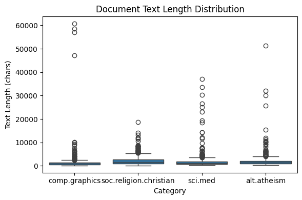
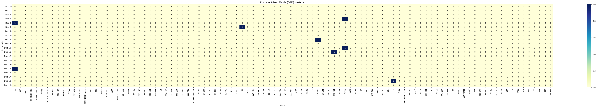
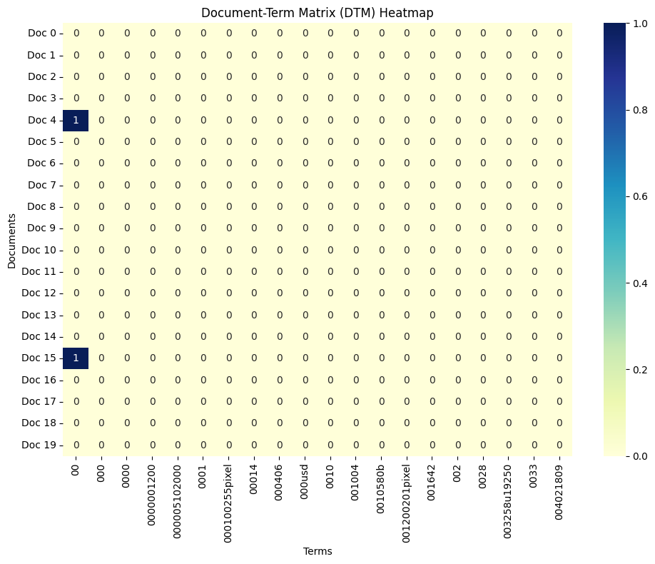
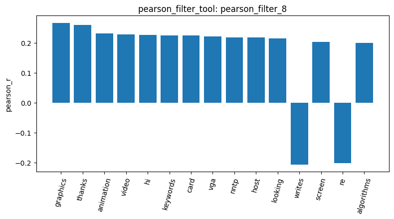
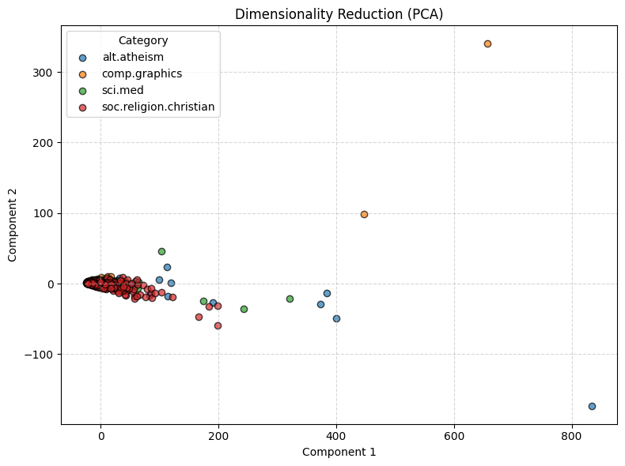
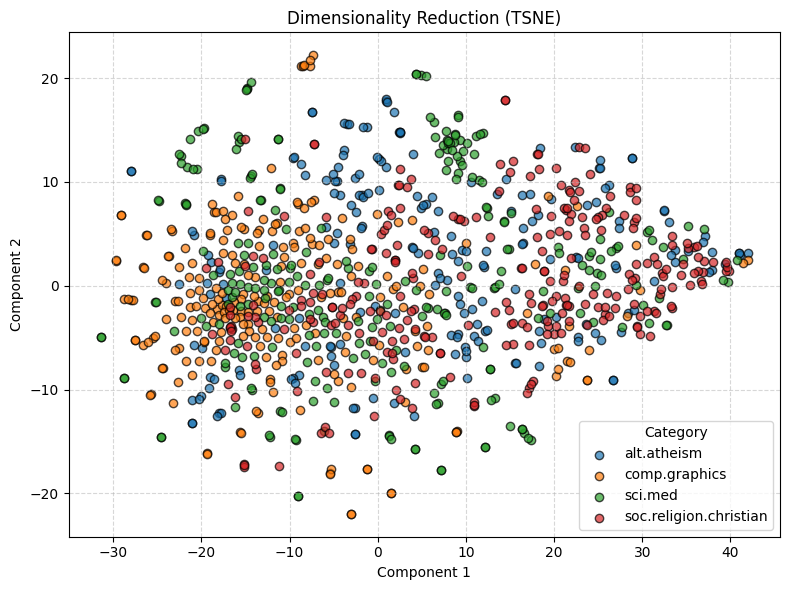
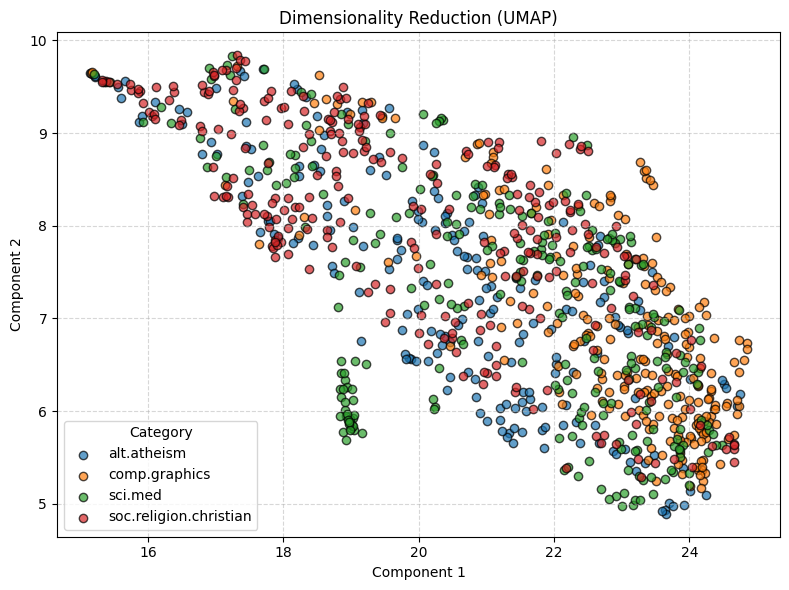

# Agentic Pipeline Report

## Dataset Loading and Sampling

Firstly, I loaded four 20 Newsgroups categories with `load_dataset`, loading 2,257 documents: 599 from `soc.religion.christian`, 594 from `sci.med`, 584 from `comp.graphics`, and 480 from `alt.atheism`. Then, we reduce the working set to 1,000 documents with `sample_data_tool`. The sampled distribution reported by `inspect_data_tool` remained reasonably balanced (277, 269, 244, and 210 documents, respectively).

## Build DTM and Filtering

From the sample, I used `build_dtm_tool` to build a 1000 x 24118 document-term matrix with 168,052 nonzero entries, or 99.3032% sparsity. The full and zoomed heatmaps make this sparsity visible: most document-term cells are zero, while only isolated terms occur in each previewed document. I then used `variance_filter_tool` with a threshold of 0.05. The filter kept 1,748 terms and removed 22,370. For the `comp.graphics` target, the exploratory zero-threshold run of `pearson_filter_tool` retained all terms, whereas the same tool at 0.1 retained only 442 of 24,118. Some of the strongest positive correlations were `graphics` (0.2672), `thanks` (0.2597), `animation` (0.2319), and `video` (0.2272), while some of the strongest negative terms include `writes` (-0.2067) and `re` (-0.2020).

## Pattern Mining

After Building the DTM and filtering it, I used `mine_patterns_tool` to find the ten most frequent TF-IDF transaction patterns for all four categories. Across `comp.graphics`, `sci.med`, `alt.atheism`, and `soc.religion.christian`, the highest-support patterns were repeatedly built from `subject`, `lines`, `organization`, and `edu`; for example, `subject` and `lines` each appeared in all 244 sampled `comp.graphics` documents. Because these are newsgroup-header tokens rather than topic vocabulary, the result indicates that metadata dominated the frequent-pattern output. A better topic-focused follow-up would remove header fields or explicitly filter these structural terms before mining.

## Dimensionality Reduction

To check whether the categories form visible groups, I projected the documents into two dimensions using the PCA, t-SNE, and UMAP algorihtms in `reduce_dimensions_tool`. The PCA plot shows the documents very concentrated in the center, so it wasn't very helpful. t-SNE does a better job at revealing local clusters, particularly for `comp.graphics`, and UMAP shows more of a gradual spread across the documents. Even so, the colors still overlap in all of the plots. 

## Binarize and Cosine Similarity

Finally, `binarize_labels_tool` encoded the 1,000 documents into one-hot format. Then I used `cosine_similarity_tool` to compare same-category document pairs identified through `inspect_data_tool`. Some documents of the same category had higher cosine similarities, but some don't.