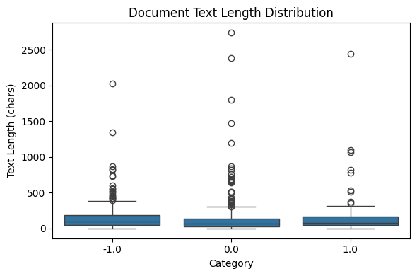
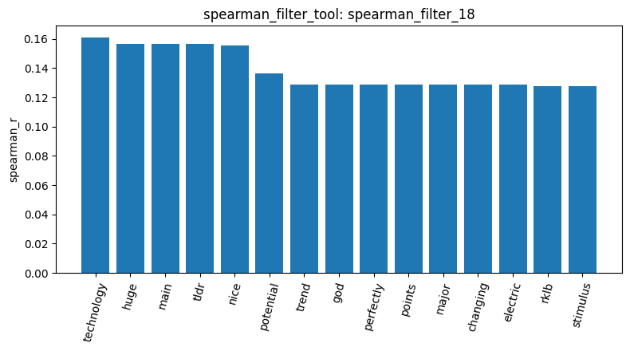
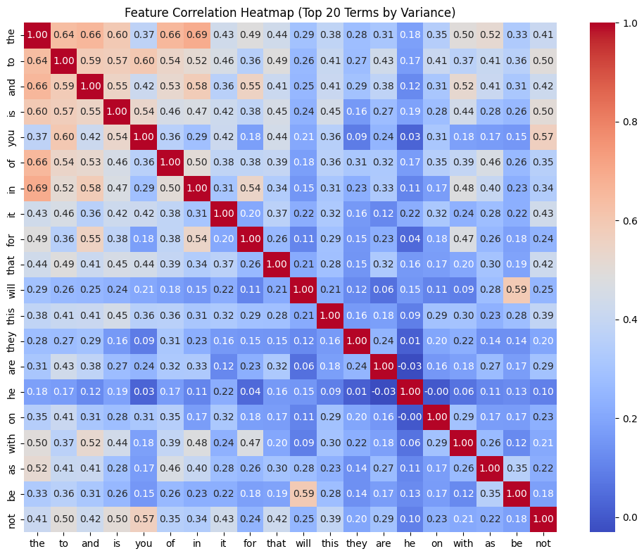
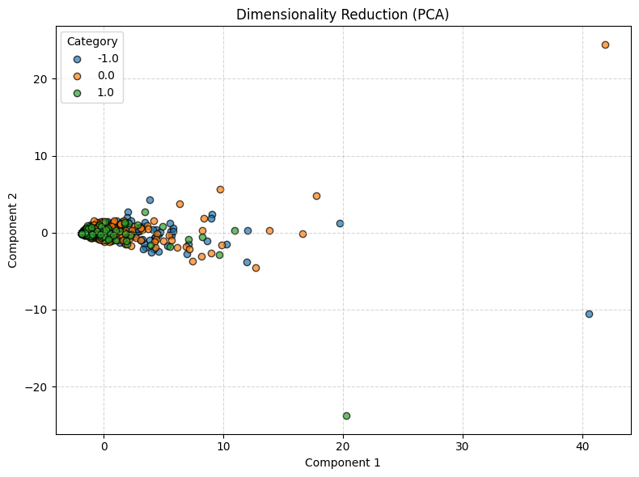
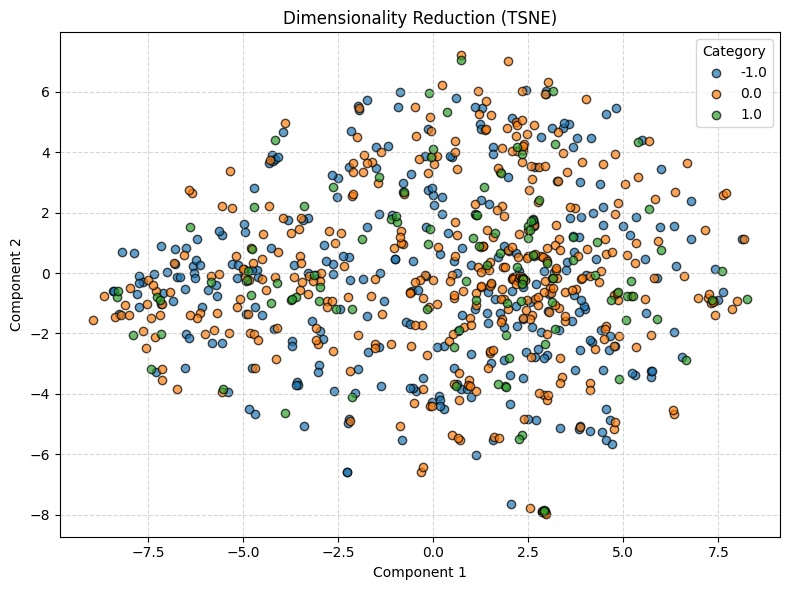
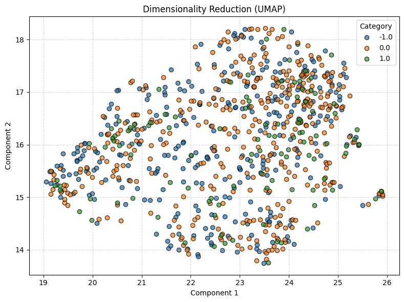

# Homework Report

## Dataset Loading and Cleaning

Firstly, I loaded 847 Reddit documents with `load_dataset`: 423 neutral, 315 negative, and 109 positive. `check_missing_tool` found no missing text. `check_duplicates_tool` removed all copies of duplicated text, leaving 813 documents. The distribution reported by `inspect_data_tool` was less balanced than the 20 Newsgroups sample, with 391 neutral, 315 negative, and 107 positive documents.

## Build DTM and Filtering

From the cleaned data, I used `build_dtm_tool` to build an 813 x 4313 document-term matrix with 16,659 nonzero entries, or 99.5249% sparsity. `term_frequency_tool` showed that common words `the` (874) and `to` (554) appeared most often. I then used `variance_filter_tool` with thresholds of 0.1 and 0.05, keeping 45 and 93 terms, respectively. For the positive target, `spearman_filter_tool` kept 696 terms at 0.05, only 5 at 0.15, and 33 at 0.12. Some of the strongest positive correlations were `technology` (0.1609), `huge` (0.1563), and `nice` (0.1555). I also used `feature_correlation_matrix_tool` on the top 20 terms by variance. The heatmap mostly shows common words, including a correlation of 0.6922 between `the` and `in`, rather than clear sentiment signals.

## Pattern Mining

After building the DTM and filtering it, I used `mine_patterns_tool` to find the twenty most frequent TF-IDF transaction patterns for all three categories. All patterns contained a single term. Positive posts included `just` in 15 documents and `good` in 12, while neutral posts included `market` in 28. Negative posts included `trump` in 45 documents and `china` in 33. Unlike the 20 Newsgroups results, these patterns contain discussion topics rather than header terms. However, `good` appeared in all three categories, so a frequent word alone does not identify sentiment.

## Dimensionality Reduction

To check whether the categories form visible groups, I projected the documents into two dimensions using the PCA, t-SNE, and UMAP algorithms in `reduce_dimensions_tool`. The PCA plot still shows most documents crowded together near the origin, so it wasn't very helpful. t-SNE and UMAP spreads the documents out more, but the colors still overlap in all of the plots, with no clear separation between positive, neutral, and negative categories.

## Binarize and Cosine Similarity

Finally, `binarize_labels_tool` encoded the 813 documents into one-hot format. Then I used `cosine_similarity_tool` to compare same-category document pairs identified through `inspect_data_tool`. Documents of the same category may still have low cosine similarity values on most times. Meanwhile, documents that share the same word like "Trump" tend to have a higher cosine similarity value.
